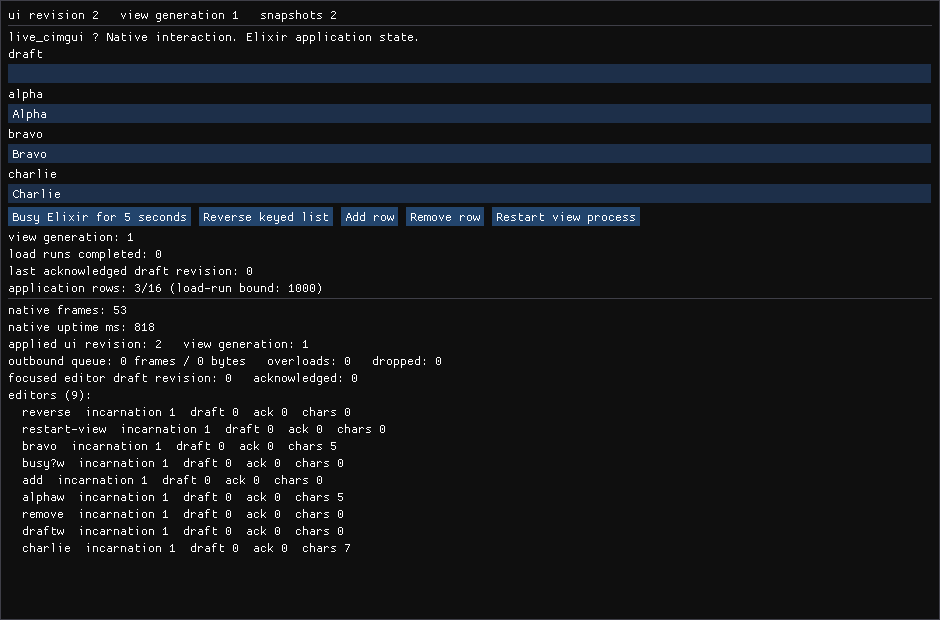

# live_cimgui

Native Elixir UI with LiveView semantics: a view process describes the UI, a
native host draws it with [Dear ImGui](https://github.com/ocornut/imgui) through
[Zigler](https://github.com/E-xyza/zigler) and
[cimgui](https://github.com/cimgui/cimgui), and the window keeps rendering and
accepting input while Elixir is busy.

Three properties define the project, and each one is covered by tests that run
real native code:

* **The native host renders a cached description on its own frame loop.** Elixir
  is *not* called per frame: a description is validated, encoded once, submitted,
  and evaluated through cimgui every frame inside the host process. During a
  five-second Elixir callback the window still draws, still accepts typing, and
  still reports frame progress.
* **Views are restartable without touching the window.** A view process crash or
  restart keeps the native window, its identity, and its in-progress text; the
  replacement view gets a fresh view generation and reconciles through an explicit
  handshake.
* **Native lifetime and application lifetime are independent.** A window's
  lifetime never defines an application's lifetime, and an application's state is
  never owned by the window: application services are ordinary supervised
  processes.

## Quick start

```sh
mix deps.get
mix compile                       # Elixir + NIF + native host executable
mix live_cimgui.demo              # opens the stress-test window
```

Requires Elixir 1.20, Erlang/OTP 28, Zig 0.16.0, `libsdl2-dev`, `libgl1-mesa-dev`,
and a display (X11, Wayland, or WSLg). See `docs/TESTING.md` for the exact
toolchain and every acceptance command.



The image above is not a mock-up: it is the demo window's framebuffer, read with
`glReadPixels` by the native host and written to a PPM file
(`{:test_input, :capture, path}`, see `docs/TESTING.md` §4b). The same path backs
`test/live_cimgui/gui/capture_test.exs`, which asserts on those pixels.

## A minimal runnable example

```elixir
defmodule CounterView do
  use LiveCimgui.View
  import LiveCimgui.UI

  def mount(_params, _session, socket), do: {:ok, assign(socket, count: 0)}

  def render(assigns) do
    column([
      text("Counter"),
      row([
        button("increment", "Add one"),
        button("reset", "Reset")
      ]),
      input("note", assigns.note || "", label: "note:"),
      diagnostics()
    ])
  end

  def handle_event("increment", _params, socket),
    do: {:noreply, assign(socket, :count, socket.assigns.count + 1)}

  def handle_event("reset", _params, socket), do: {:noreply, assign(socket, :count, 0)}

  def handle_event("note", %{"value" => text}, socket),
    do: {:noreply, assign(socket, :note, text)}
end

{:ok, manager} =
  LiveCimgui.HostManager.start_link(
    view: CounterView,
    title: "live_cimgui — counter"
  )

# The window is native and independent of Elixir:
LiveCimgui.HostManager.status(manager)
LiveCimgui.HostManager.inspect_host(manager)   # text, caret, selection, revisions
LiveCimgui.HostManager.close(manager)
```

`button/3`'s first argument is the widget's stable identity and, by default, the
event name `handle_event/3` receives. `input/3`'s first argument is the editor's
identity: it must come from application data (a key), never from a row index or a
label, because that identity is what keeps an editor's text, caret, and selection
attached to the right thing when the list is reordered.

## The ownership contract

```
Application service  →  owns application state and work        (supervised process)
LiveCimgui.View      →  owns presentation state + subscriptions (one process per window)
Native host          →  owns immediate interaction + graphics   (one OS process, main thread)
Host manager         →  owns the native resource + protocol     (one process, never blocks on views)
```

See `docs/ARCHITECTURE.md` for the process/thread map, the lifecycle matrix
(view crash, host crash, window close, shutdown, NIF unload), what the build
produces, and why the platform loop cannot live in a NIF.

## Documentation

| Document | Contents |
|---|---|
| `docs/ARCHITECTURE.md` | layers, ownership, thread model, lifecycle, platform backend, C++ surface |
| `docs/PROTOCOL.md` | framing, every message, revision ownership, text sync, queue bounds, recovery rules |
| `docs/TESTING.md` | toolchain pins, every command, what each suite covers, manual checks, limitations |
| `docs/PLAN.md` | the implementation plan and the pinned dependency decisions |
| `native/vendor/cimgui/UPSTREAM.md` | exact cimgui/Dear ImGui revisions and licenses |

## Commands

```sh
mix compile                        # Elixir, Zigler NIF, native host executable
mix test                           # display-independent suite
mix live_cimgui.native_test        # host unit tests (Zig)
mix live_cimgui.gui_test           # real-window acceptance tests
mix live_cimgui.demo               # stress-test window
mix release                        # release including both native artifacts
mix ci                             # the project's full quality gate
```

## Compatibility level

The view callbacks and assigns are Phoenix LiveView's
(`LiveCimgui.ViewServer` drives `mount/3`, `render/1`, `handle_event/3`,
`handle_info/2` over a `%Phoenix.LiveView.Socket{}`, with
`Phoenix.Component.assign/2,3`). This is **callback compatibility, not a
LiveView runtime**: there is no transport, no `handle_params/3`, no components or
slots, no HEEx/HTML rendering, and no change-tracking diff engine — the native
target is diffed structurally by publishing complete validated descriptions.
Arbitrary HTML LiveViews do not work unchanged, and this is not a renamed
GenServer either: the callbacks are the LiveView view callbacks. All
version-sensitive Phoenix usage is isolated in `LiveCimgui.PhoenixAdapter` and
pinned by `test/live_cimgui/phoenix_adapter_test.exs`.

## Platform support

| Platform | Status |
|---|---|
| Linux x86_64, glibc, X11/Wayland via SDL2, OpenGL 3.3+ | **tested** (Ubuntu 24.04, WSLg) |
| SDL3 backend | not implemented; see `docs/ARCHITECTURE.md` section 5 for why SDL2 was used |
| macOS, Windows, aarch64, musl | untested and unsupported by this milestone |
| Bare framebuffer (no X11/Wayland) | not supported: an X11 or Wayland window is not a framebuffer |

## Limitations

* No template compiler yet: the typed constructors in `LiveCimgui.UI` are the
  render target (text, button, single-line input, row, column, keyed collections,
  host diagnostics).
* IME composition is passed through to Dear ImGui but is **not** verified
  automatically; `docs/TESTING.md` records it as a manual check.
* No docking, multi-viewport, themes, or broad widget coverage; one window per
  host manager.
* Text drafts are NUL-terminated C strings: an embedded NUL ends the draft
  (documented in `docs/PROTOCOL.md`).
* Incremental patches are not implemented: every update is a complete snapshot.

## Licenses

* `native/vendor/cimgui` — MIT, cimgui (© Stephan Dilly), see
  `native/vendor/cimgui/LICENSE`.
* `native/vendor/cimgui/imgui` — MIT, Dear ImGui (© Omar Cornut), see
  `native/vendor/cimgui/imgui/LICENSE.txt`.
* Everything else in this repository is MIT, © Matt Neel — see `LICENSE`.
